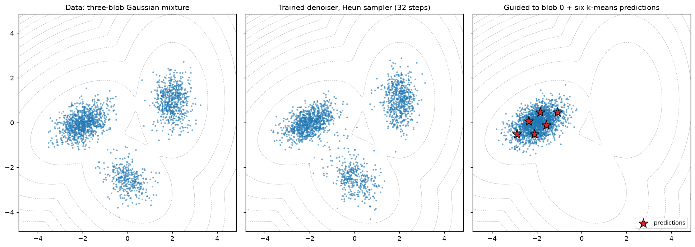

# EDM diffusion

An EDM-style diffusion model on a three-component 2-D Gaussian mixture:
denoiser, deterministic and stochastic samplers, log-likelihood through the
probability-flow ODE, classifier guidance, and six predictions with
confidences by k-means.



Left: 2,000 mixture samples over log-density contours. Middle: 2,000 samples
from the trained denoiser, Heun sampler, 32 noise levels. Right: samples
guided to one component, with the six k-means predictions.

## Run

```
python -m pip install torch matplotlib pytest
make test                           # run the tests
make figure                         # docs/figure.png
python train.py --out denoiser.pt   # train the denoiser
```

## Layout

`edm/`: `mixture` -> `diffusion` -> `loss` -> `precondition` -> `network` ->
`sample` -> `likelihood`, `predictions`, `guidance`. Denoiser: 3 x 128 SiLU
MLP with EDM preconditioning, Adam 1e-3, batch 4,096, fresh mixture samples
each step.
